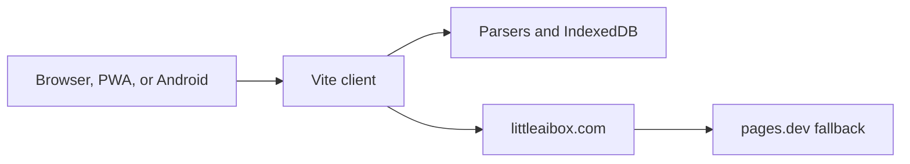
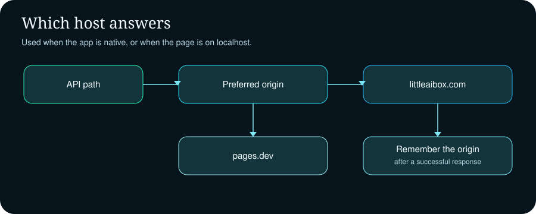
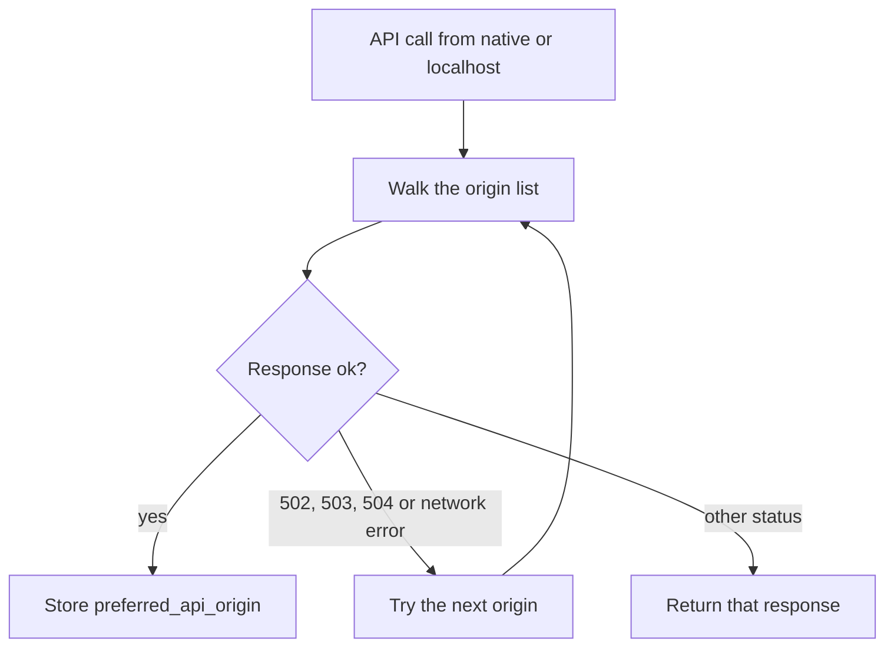

# Little Box

<p align="center">
  
</p>

<p align="center">
  
</p>

Little Box is a privacy-first conversation workspace for chat, writing, translation, coding help, and document reading. One Vite client runs in the browser, as an installed progressive web app, and inside a Capacitor Android shell. People bring their own model keys. Conversation state and parsed files stay on the device unless a feature explicitly calls the network.

The picture above is the product illustration shipped with this folder. The running client is not a React or Python service. It is the Vite application in this repository, package `littleaibox`, version `3.0.7`. The live site is [littleaibox.com](https://littleaibox.com).

| | |
| --- | --- |
| Package | `littleaibox` `3.0.7` |
| Client | Vite 7 and Tailwind 4 |
| Native shell | Capacitor 7 for Android |
| Local database | IndexedDB `LittleAIBoxDB`, version 2 |
| Default origin | `https://littleaibox.com` |
| Fallback origin | `https://littleaibox.pages.dev` |
| Support | [support@littleaibox.com](mailto:support@littleaibox.com) |
| License | MIT, as stated in [LICENSE](LICENSE) |

```text
npm install
npm run dev
npm run build
```

`predev` and `prebuild` run `scripts/copy-i18n.mjs` before Vite. Put model keys in the application UI. Do not commit them.

## Who it is for

| Audience | What they do here |
| --- | --- |
| Developers | Ask coding questions with a file attached, without uploading a whole workspace |
| Readers of papers and decks | Open PDF, DOCX, PPTX, and XLSX in the browser |
| People on a blocked network | Let the native or local client walk the fallback origin list |
| Anyone keeping their own keys | Store two keys and keep chats in IndexedDB |
| Subscribers and key holders | Receive the higher ceilings in `src/entitlements.js` |

Voice input, task presets, mind maps, and an optional research mode live in the same client. Share pages, policy pages, and subscription screens are routes, not a second product.

## What this client refuses to pretend

| Claim | What the code actually does |
| --- | --- |
| Keys live in the repository | Keys are entered in the UI and stripped from sanitized user objects |
| Every request is local | Parsing and chat storage are local. Model calls still leave the device |
| One host is the only host | Native and localhost API calls walk a short origin list |
| A cached POST is a source of truth | POST, PUT, and DELETE to `/api/` and `/auth/` are network-only |
| Office math is dropped | OMML fractions, roots, scripts, and matrices become LaTeX |
| Monthly, quarterly, and yearly are different engines | Those plan codes all normalize to `pro` |
| The illustration's stack list is the build | The build file is `package.json`, not the poster |

## How the product is put together


| Layer | Where it lives | What it owns |
| --- | --- | --- |
| Shell | `index.html` | Theme boot, language, and the page frame |
| Conversation | `src/main.js` | Presets, keys, timeline, and message actions |
| Router | `src/router.js` | Address bar, history, and route names |
| Origin adapter | `src/api-config.js` | Rewrite and fallback for native and localhost |
| Store | `src/db.js` | Chats and settings in IndexedDB |
| Files | `src/file-parsers/` and `src/file-export/` | Read PDF and Office files, write them back out |
| Worker | `src/sw-custom.js` and `vite.config.js` | Precache and runtime caches |
| Native update | `src/apk-update-manager.js` | Compare package versions on Android |



## Which host answers

On the public website, relative API calls stay on that site. On Android, and on `localhost`, `127.0.0.1`, or `::1`, `src/api-config.js` rewrites API traffic.

A path counts as API traffic when it starts with `/api/`, `/auth/`, `/image-proxy`, or `/image-get`, or when the method is not GET or HEAD and the path is `/`.

$$
O = \langle o_{\mathrm{preferred}},\ \texttt{https://littleaibox.com},\ \texttt{https://littleaibox.pages.dev} \rangle
$$

The preferred value is kept only when it is already one of those two hosts. The client tries the list in order. Status `502`, `503`, or `504`, or a thrown network error, advances to the next origin. Any other status returns immediately. The first successful response is written to `localStorage` under `preferred_api_origin`.





## Keys and model labels

Two user-supplied keys are supported. Older records may keep both inside `custom_api_key` as a comma-separated pair. Newer records keep the second key in `custom_api_key_t`. Sanitized copies of the user object delete both fields before they are stored for display. A hint flag records only that a key exists, not the key itself.

`src/relay-models.js` turns a relay id into a label. A leading `models/` is removed. The first token selects the brand.

| Prefix | Brand | Join |
| --- | --- | --- |
| `deepseek` | DeepSeek | hyphen |
| `gemini` | Gemini | space |
| `gpt` | GPT | hyphen |
| `claude` | Claude | space |
| `grok` | Grok | space |
| anything else | Capitalized token | space |

Adjacent numeric tokens become one dotted number, so `3` and `5` read as `3.5`. A token shaped like `v2` becomes `V2`.

<p>
  
  
  
  
  
</p>

The marks above are the icons already stored under `public/ai_icons/`. They are labels for the relay, not proof that a particular host is configured.

## Documents and rendered replies


| Reader | Module | Output |
| --- | --- | --- |
| PDF | `src/file-parsers/pdf.js` | Extracted text |
| Word | `src/file-parsers/docx.js` | Text, with Office math converted |
| PowerPoint | `src/file-parsers/pptx.js` | Slide text, with the same math conversion |
| Excel | `src/file-parsers/excel.js` | Sheet text |
| Word export | `src/file-export/word.js` | A document written from the conversation |
| PDF export | `src/file-export/pdf.js` | A PDF written from the conversation |
| Excel export | `src/file-export/excel.js` | A workbook written from the conversation |
| PowerPoint export | `src/file-export/ppt.js` | A deck written from the conversation |

An Office fraction node `f` becomes LaTeX. The numerator and denominator are the OMML children `num` and `den`.

$$
\texttt{f}(\mathrm{num},\mathrm{den}) \mapsto \frac{\mathrm{num}}{\mathrm{den}}
$$

The same converter in `src/file-parsers/mathUtils.js` emits the rest of the common Office math forms.

| OMML tag | LaTeX shape |
| --- | --- |
| `sSup` | `{base}^{sup}` |
| `sSub` | `{base}_{sub}` |
| `rad` with a degree | `\sqrt[deg]{base}` |
| `rad` without a degree | `\sqrt{base}` |
| `m` | `\begin{matrix} ... \end{matrix}` |

Property tags that end in `Pr`, and the ignored presentation tags listed in that file, contribute no text. Replies can then be drawn with Mermaid (`src/mermaid-renderer.js`), Vega-Lite (`src/vega-renderer.js`), or a markmap mind map (`src/mindmap-mode.js`). Mind map scripts load from `/libs/d3.min.js`, `/libs/markmap-lib.js`, `/libs/markmap-view.js`, and `/libs/markmap-toolbar.js`.

While a reply streams, image URLs are scanned on a 30 millisecond timer.

$$
\Delta t_{\mathrm{stream}} = 30\,\mathrm{ms}
$$

The scanner in `src/stream-image-runtime.js` accepts Markdown images and bare URLs whose path ends in `png`, `jpg`, `jpeg`, `webp`, `gif`, `bmp`, `svg`, or `avif`.

## Local records

IndexedDB database `LittleAIBoxDB` is version 2. It has two object stores.

| Store | Key | Record |
| --- | --- | --- |
| `chats` | `userId` | `{ userId, chatsData }` |
| `settings` | `key` | Setting records addressed by key |

$$
\mathrm{chats}(\mathrm{userId}) =
\begin{cases}
\mathrm{chatsData} & \text{when the record exists} \\
\mathrm{null} & \text{when the read fails or the record is missing}
\end{cases}
$$

`getChatsFromDB` returns `null` on failure instead of throwing. `saveChatsToDB` writes the whole chat blob for that user. `clearChatsStore` removes every user, not one conversation.

Pending work that must survive a reload uses `src/sync-queue.js`. The storage key adds the user id when one is present.

$$
k(\mathrm{base},\mathrm{user}) =
\begin{cases}
\mathrm{base} & \text{if no user id is set} \\
\mathrm{base}\,\Vert\,\texttt{"_"}\,\Vert\,\mathrm{user} & \text{otherwise}
\end{cases}
$$

A saved queue is `{ items, order }`. `upsertQueueItem` writes the item and appends the id only when it is not already in `order`. `removeQueueItem` deletes the item and drops that id from the order. An empty queue removes the `localStorage` key. If a newer per-user key is missing and a legacy key still holds data, the loader copies the legacy value and deletes the old key.

## Cache windows


The service worker is `src/sw-custom.js`, injected by Vite PWA. A precached file may be at most 4 MiB.

$$
4 \times 1024^{2} = 4\,194\,304 \text{ bytes}
$$

One day is \(86\,400\) seconds. The runtime rules in `vite.config.js` are:

| Cache | Handler | Cap | Age |
| --- | --- | --- | ---: |
| `images-cache` | Cache first | 60 | \(30 \times 86400\) seconds |
| `libs-cache` | Cache first for `/libs/` | 50 | \(30 \times 86400\) seconds |
| `api-data-cache` | Network first, 3 second timeout, HTTP 200 only | 100 | \(30 \times 86400\) seconds |
| `cdn-fonts-cache` | Cache first for `cdn.jsdelivr.net` | 10 | \(180 \times 86400\) seconds |
| `share-page-cache` | Stale while revalidate for `/share/` | 20 | \(7 \times 86400\) seconds |

GET `/api/chats/` and GET `/auth/me` may use the network-first cache. Mutations do not. Favicon and apple-touch icons are left out of the precache glob.

The production build minifies with Terser, runs two compress passes, drops `console` and `debugger`, and stamps `__APP_BUILD_ID__`.

$$
\mathrm{buildId} = \mathrm{APP\_BUILD\_ID} \lor \mathrm{VERCEL\_GIT\_COMMIT\_SHA} \lor \mathrm{CF\_PAGES\_COMMIT\_SHA} \lor \mathrm{GITHUB\_SHA} \lor \mathrm{ISO\ time}
$$

The first of those values that is set wins. Vendor modules are split into a `vendor` chunk. The chunk-size warning starts at 700 kB.

