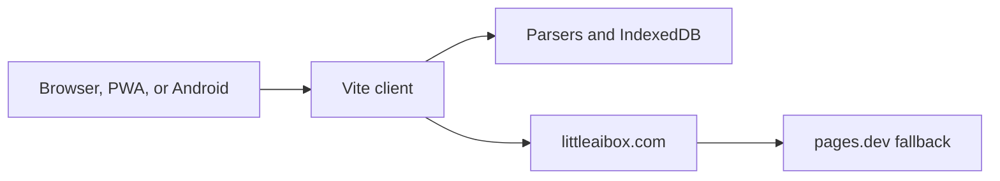

# Little Box

<p align="center">
  
</p>

<p align="center">
  
</p>

Little Box is a privacy-first conversation workspace for chat, writing, translation, coding help, and document reading. One Vite client runs in the browser, as an installed progressive web app, and inside a Capacitor Android shell. People bring their own model keys. Conversation state and parsed files stay on the device unless a feature explicitly calls the network.

The picture above is the product illustration shipped with this folder. The running client is not a React or Python service. It is the Vite application in this repository, package `littleaibox`, version `3.0.7`. The live site is [littleaibox.com](https://littleaibox.com).

| | |
| --- | --- |
| Package | `littleaibox` `3.0.7` |
| Client | Vite 7 and Tailwind 4 |
| Native shell | Capacitor 7 for Android |
| Local database | IndexedDB `LittleAIBoxDB`, version 2 |
| Default origin | `https://littleaibox.com` |
| Fallback origin | `https://littleaibox.pages.dev` |
| Support | [support@littleaibox.com](mailto:support@littleaibox.com) |
| License | MIT, as stated in [LICENSE](LICENSE) |

```text
npm install
npm run dev
npm run build
```

`predev` and `prebuild` run `scripts/copy-i18n.mjs` before Vite. Put model keys in the application UI. Do not commit them.

## Who it is for

| Audience | What they do here |
| --- | --- |
| Developers | Ask coding questions with a file attached, without uploading a whole workspace |
| Readers of papers and decks | Open PDF, DOCX, PPTX, and XLSX in the browser |
| People on a blocked network | Let the native or local client walk the fallback origin list |
| Anyone keeping their own keys | Store two keys and keep chats in IndexedDB |
| Subscribers and key holders | Receive the higher ceilings in `src/entitlements.js` |

Voice input, task presets, mind maps, and an optional research mode live in the same client. Share pages, policy pages, and subscription screens are routes, not a second product.

## What this client refuses to pretend

| Claim | What the code actually does |
| --- | --- |
| Keys live in the repository | Keys are entered in the UI and stripped from sanitized user objects |
| Every request is local | Parsing and chat storage are local. Model calls still leave the device |
| One host is the only host | Native and localhost API calls walk a short origin list |
| A cached POST is a source of truth | POST, PUT, and DELETE to `/api/` and `/auth/` are network-only |
| Office math is dropped | OMML fractions, roots, scripts, and matrices become LaTeX |
| Monthly, quarterly, and yearly are different engines | Those plan codes all normalize to `pro` |
| The illustration's stack list is the build | The build file is `package.json`, not the poster |

## How the product is put together


| Layer | Where it lives | What it owns |
| --- | --- | --- |
| Shell | `index.html` | Theme boot, language, and the page frame |
| Conversation | `src/main.js` | Presets, keys, timeline, and message actions |
| Router | `src/router.js` | Address bar, history, and route names |
| Origin adapter | `src/api-config.js` | Rewrite and fallback for native and localhost |
| Store | `src/db.js` | Chats and settings in IndexedDB |
| Files | `src/file-parsers/` and `src/file-export/` | Read PDF and Office files, write them back out |
| Worker | `src/sw-custom.js` and `vite.config.js` | Precache and runtime caches |
| Native update | `src/apk-update-manager.js` | Compare package versions on Android |



